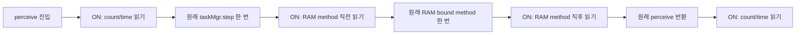

[확인 기록] MetaDrive × MD-V3 7단계 개발 결과

카메라별 `perceive → task step → RAM method → 반환` 경계를 연결하는 CPU 관측기와 미래 실행 설계를 만들었다. 원래 메서드는 한 번씩 호출하고 같은 객체를 반환하며, ON에서만 TaskManager 소유 clock의 count/time을 읽는다. **이번 단계의 검증은 합성 CPU 계약 테스트다. 실제 native frame/time 기록·새 canary·ABBA 결과는 없으며, 새 workflow/request도 만들지 않았다.**

## A. 변경과 이전 작업 구분

저장소 `rownlvh8875-coder/big-model-closed-loop-benchmark`, 브랜치 `design/engine-clock-boundaries`, base `4a0e7eac391f7c101d77293d10e76659a1390860`이다. 관측기 source는 `8eef1e8c69708da4b72c4b26e4e88305fe696771`이며 최종 문서 HEAD와 구분한다. 새 `scripts/engine_clock_boundaries.py`와 `tests/test_engine_clock_boundaries.py`, 설계·계획·비활성 프로토콜·audit를 추가했다. 기존 continuation만 갱신했다. Producer65/protected13/baseline43/43workflows/소비된request·acceptance/renderer/converter/action/default/6-16-10은 보존했다. 관측기는 아직 소비된 producer registry 밖이다. PR38 위의 별도 Draft로 유지한다.

이전 native_raw_pixel_clock는 전체 카메라 쌍 전후의 globalClock과 대체 capture mode를 비교했고, 이전 callback profiler는 실제 Python callback 순서를 측정했다. 완료된 실험을 반복하거나 그 수치를 이번 source의 측정으로 재명명하지 않는다. 이번 모듈은 고정된 원래 경로에 추가 렌더링·step·RAM복사·clocksetter 없이 경계별 연결을 제공한다. Callback profiler나 task제거·재등록은 없다.

## B. 구현한 CPU 계약

공개 API는 `camera_clock_scope(provider, enabled, trace, *, max_pairs=6)`와 `validate_clock_trace(trace)`다. 모듈은 표준 라이브러리만 쓰며 Panda/MetaDrive/NumPy/ORT import, clock구성·변경, 파일I/O나 subprocess가 없다. Trace는 새 dict이고 같은 Python thread 안에서만 사용한다. 기본6쌍, 테스트 가능한 최대6쌍 범위이며 미래 runner는 정확히6쌍을 고정해야 한다.

다음은 설계 경로이며 실제 engine trace 그림이 아니다.

Task step 호출/반환도 wrapper event로 기록한다. 두 clock getter는 `engine.taskMgr.globalClock`에서 바인딩하고 읽기마다 같은 객체인지 확인한다. 별도의 ClockObject.getGlobalClock와 같다고 가정하지 않는다. OFF에서는 이 관측기 자체가 clock owner/getter에 접근하지 않으며 snapshot은null이다. 원래 engine 내부의 clock 연산은 그대로이고 이 추가 getter 예산에 포함하지 않는다.

정상6쌍은12perceive·12원래step·12RAM·72events다. ON은48snapshot/96getter invocations이며, OFF의 추가clock읽기는0이다. Snapshot은 count를 읽고 time을 읽는 두 별도 호출로 **atomic하지 않다**. Signed64 count와 finite float time을 그대로 보존하고 +1·증가·고정dt·동일값을 성공조건으로 만들지 않는다. 음수·비단조 유한값도 데이터다. Clock정보는 GPU frame identity/completion/freshness나 callback 실행순서를 뜻하지 않는다.

Road/Wide의 perceive/RAM과 taskMgr.step, 총5개 instance attribute의 원래 소유상태·객체를 복구한다. 인자와 반환객체를 그대로 전달하고 nested/orphan/wrong-thread/중복/순서/예산 위반은 원래 메서드의 추가 side effect 전에 막는다. 호출자가 예외를 잡아도 실패를 latch해 완료 trace로 승격하지 않는다. 내부 wrapper 변수명을 원래kwargs로 오인하던 문제는 회귀 테스트로 재현한 뒤 closure factory로 수정했다.

실패 시 각메서드·getter의 attempted/returned, 이미읽은 count/time, bounded error와 복구오류를 남긴다. 원래 body예외는 primary로 유지하며 복구오류는 note와 trace에 기록한다. 예를 들어 RAM직전 getter가 실패하면 이미돌아온 step과 RAM미호출을 구분하고, RAM직후 getter가 실패하면 실제 RAM반환을 보존한다. 오류·불완전·counter/event불일치변조·OFF값주입·복구미확정 trace는 성공 validator를 통과하지 못한다. JSON한도64KiB다.

이 trace는 메모리에만 있다. 저장·hardkill복구를 입증하지 않으며, 미래 runner는 close후 또는 복구가능실패후의 bounded자료를 따로 보존해야 한다. 성공 validator의 이름도 `CPU_BOUNDARY_TRACE_VALIDATED`이며 synthetic fixture가 통과할 수 있다. Native admission이나 실제 provider 증명은 아니다.

## C. 비활성 미래 실행 설계

[프로토콜 설계 JSON](evidence/STAGE7_ENGINE_CLOCK_PROTOCOL_DESIGN.json)의 status는 `INACTIVE_DESIGN_CPU_CONTRACT_ONLY`, actualrun/artifact는null, admission_implemented=false다. Actions request로 쓰는 파일이 아니며 이번 작업의 현재 native/provider/GPU/공식모델/ORT 호출은 모두0이다.

제안은 새source의 ONcanary1provider를 실제root+fresh 원본수락한 뒤, 그 직접 자식 metadata활성화에서 OFF0/ON0/ON1/OFF1을 각각한번 실행하는 것이다. 고정 pose4+2,6쌍/provider,총최대5providers/30pairs/60RAM/60원래step으로 startup은 별도다. 기존모델 지연·adaptive6/16/10을 재현하는 실험은 아니다. 어느 phase도 retry/연장/남은allowance를 재사용하지 않는다.

양 arm에서 기존 Texture marker를 공통ON으로 유지하고 clockgetter만 ON/OFF로 나눈다. `marker_scope(enabled=True)`를 먼저, 새 clock scope를 다음에 설치한다. 복구는 역순이다. 따라서 clock의 RAM창은 공통 Texture/RAM/hash wrapper를 감싸며 hardware RAM read만의 시간창이 아니다. 이전 markerOFF arm이나 원래 비계측 경로와도 다르다. 이 composition은 CPU fixture에서 원본 marker_scope를 그대로 호출해 검사했다.

| 미래 제안 항목 | 한6쌍 ONcase | 전체canary+ABBA |
| --- | --- | --- |
| Clock snapshots |48 |144 |
| Clock getter invocations |96 |288 |
| 공통Texture sequence readings |24 |120 |
| 공통Texture getter invocations |48 |240 |
| 전체observer getter invocations |144 |528 |

Clock은 전체5case중3개ON,Texture는5case모두ON이다. 현재실제clock관측수는0이다. 미래 child270s/case300s/phase1320s,논리retention32MiB/disk40MiB/log1MiB/caseJSON2MiB/dataset192MiB와 별도빈Mesa cache를 제안하며, clocktrace64KiB는 기존JSON예산 안에 포함한다.

미래producer70은 기존65+이관측기/테스트2+새runner/테스트/workflow3이다. 별도의 새mutable request를Git에 바인딩해야 한다. 실제API·runtime·source70Gitblobs·uniqueattempt1·FD>=10/liveparent/nonce/group/고정schedule gate를 constructor 전에 구현·검토해야 한다. Canary 원본ZIP/크기/digest/실제raw 검증과 독립수락, directparent·metadata-only·producer/runtime동결도 필요하다. 이 설계서나 합성테스트는 그 게이트를 대체하지 않는다.

## D. 검증·소스 참조·기존 게이트

새23개 CPU테스트는 ON/OFF·정확한호출수·4경계·객체/인자전달·own/inherited복구·부분설치·body/getter/RAM/복구오류·잡힌예외·중첩/orphan/중복/다른thread/순서/예산·owner변경·signed/nonmonotonic/finite값·위조trace·기존Texturewrapper composition을 검사한다. 초기22RED는 모듈부재 assertion이며 모든경계를 독립적으로 RED관찰했다고 주장하지 않는다. 별도kwargs회귀1개는 실제잘못된Road/Wide분기로 RED였고 수정후통과했다. Targeted23/0.159s,전체585/70.999s/선택7skip이 통과했다. Baseline generated SMALL graph는 별도다. Fresh 독립검토는 `a759ca236f17cddfd7593f7a045f972845881ee7`에서 지적0/PASS였고 targeted23개를0.193s에 별도로 통과시켰다. [독립검토](evidence/STAGE7_ENGINE_CLOCK_OBSERVER_REVIEW.json)의 SHA는 `4c89507395c20236cbff330e78433f96eeed165d466d8224ec4c4ca9826bbd6b`다. 그 뒤 문서metadata만 바꿨으며 code/test/비활성protocol은 동일하다. 최종기본CI는 별도 실제run/job으로 PR설명에 기록한다.

[Source/검증 audit](evidence/STAGE7_ENGINE_CLOCK_OBSERVER_AUDIT.json)은 실제trace/native run/artifact를null로 두고6개 참조파일의SHA와검증로그해시를 보존한다. 로컬 Panda TaskManager 참조의 초기화는 manager소유clock을저장하고 step은 그clock을쓴다. 하지만 배포metadata/로컬파일은 실제CI설치파일·nativewrapper허용·GPUshader/engine clock동작의증명이 아니다. 파일만읽었으며 Panda엔진/clock객체를구성하지 않았다.

공식strict **FAIL**,확대시나리오미실행,원래renderer0/4·역사적candidate12/12·geometry original2/4/candidate1/4·물리optics/productionISP/fullS미검증·Stage7미완료를유지한다. Main공식호출0/Cloud미게시/기존Draft미병합이다. 원본자료와controller/review기록도보존했다.

## E. 다음 순서와 판단

다음은 새runner·테스트·push전용workflow와 실행전admission을 구현하고 CPU/source review를 통과시키는 것이다. 그 뒤 실제새canary를1번 실행해 method assignment/API/clockowner/trace/raw/cleanup을 확인할 수 있다. 수락될 때만 직접자식ABBA를 등록한다. 실제결과 없이 frame진행·같은시간/GPUframe·observer neutrality·유일원인을 선언하지 않는다.

Root 판단은 현재설계+CPU계약으로범위고정(실제clock증거는미래),TaskManager소유clock+5wrapper/4snapshot(CPU오버헤드·단일thread한계),미래Texture공통ON(이전OFF/원본비계측과다름),유한signed/비단조값을그대로기록(phase/freshness미확정),inline+최종독립검토(중간독립리뷰없음),기존source/기록/Cloud/main보존(디스크/Draft체인유지)이다. 이유와비용은audit/ledger에순서대로남겼다. 최종검토가 유보한 native호환성·GPU/인과·미래admission/persistence·CI바이너리·실제canary/게시 판단도 이 제한을 유지하며, baselineCI만 root가 실제수행해 확인한다. 이 다섯 범위결정과 비용도 audit/ledger에 보존했다.
