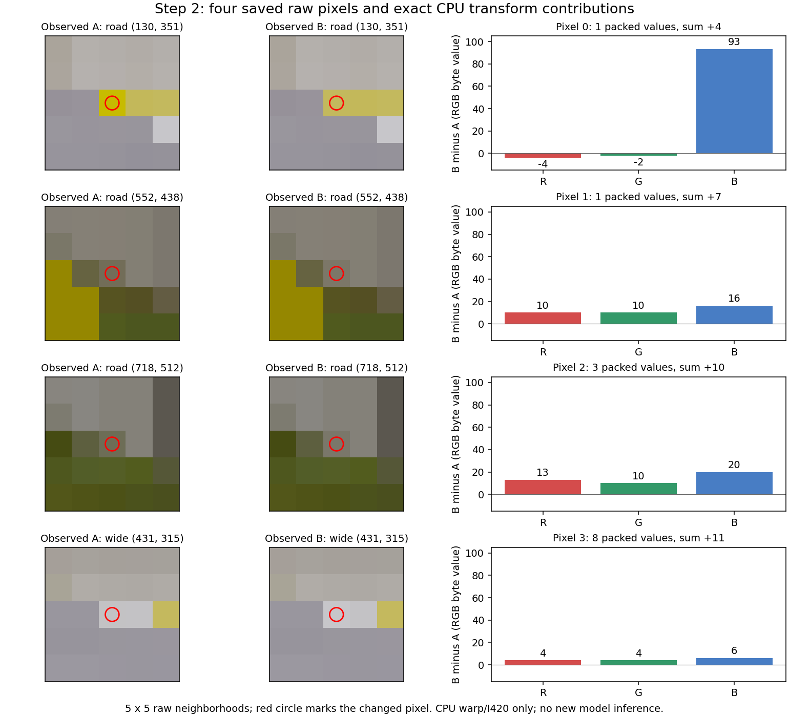

[확인 기록] MetaDrive × MD-V3 7단계 개발 결과

저장된 step2 raw 픽셀 네 개를 CPU에서 하나씩 교체해 실제 I420 입력 차이13바이트를 정확히 분해했다. Road 세 픽셀은5바이트/체크섬+21,Wide 한 픽셀은8바이트/+11을 만들었다. 조사한16개 교체 조합 중 네 개를 모두 바꾼 경우만 관측된 B 입력을 재현했다. **모델이나 네이티브 시뮬레이터는 새로 실행하지 않았다.**

## A. 변경과 원본 연결

저장소 `rownlvh8875-coder/big-model-closed-loop-benchmark`, 브랜치 `analysis/first-divergence-pixel-neighborhoods`다. 분석 도구 source는 `1c9d08fbbe7c221129fe31d50c75389af8c2b65a`, script SHA256는 `5e12227932d67a632aa65808d7be71e09826deec090ff09360c4cc6249a4af2e`다. 새 CPU 도구·테스트·문서만 추가했으며 native producer62개/보호13개/baseline43개/기존workflow42개/소비된요청은 보존했다. 이 도구를 소비된 producer 목록에 추가하지 않는다.

원본은 [run43149053427](https://github.com/rownlvh8875-coder/big-model-closed-loop-benchmark/actions/runs/43149053427), source `582cc594d127e9cde5ff3525e50c143f60285f75`, workflow415459577/job130953643905/attempt1, artifact13912454399다. ZIP27,428,724bytes/SHA256 `370ef36862e3da5bf39064acc732ff1728b0a0a549b6fba77045ce7380a8c748`,141members/187,115,633uncompressedbytes를 기존 추출본과 모두 대조했다. 현재 GitHub API의 성공 상태·source·artifact digest/크기·job을 별도로 새로 확인했다. 다운로드나 재추출은 없었다. 기존 네이티브6개/공식24회는 과거 실행의 수치이며 이번 CPU 분석의 실행 수로 집계하지 않는다.

## B. 실제 CPU 분석 결과

실제 기록된 NumPy2.4.6/OpenCV5.0.0.93과 lens intrinsics를 사용했다. Step1의 빈 교체1조합은 음성 대조이며 입력 체크섬48398753과 모든 원본이 동일했다. Step2는 raw Road3픽셀+Wide1픽셀의16개 부분집합을 모두 재계산했다. 각 입력은 A의 메모리 복사본이고 원본 파일은 변경하지 않았다. Step1·2의 관측 A/B endpoint8canvases와4packed I420/실제NEW_IMG SHA도 정확히 재구성됐다.

| ID | raw 카메라·좌표(x,y),좌상단 원점 | RGB A → B | 단일 교체의 packed 차이 | 체크섬 증가 |
| --- | --- | --- | --- | --- |
| 0 | Road(130,351) | (199,187,0)→(195,185,93) | 1바이트 | +4 |
| 1 | Road(552,438) | (114,109,88)→(124,119,104) | 1바이트 | +7 |
| 2 | Road(718,512) | (109,109,86)→(122,119,106) | 3바이트 | +10 |
| 3 | Wide(431,315) | (195,194,196)→(199,198,202) | 8바이트 | +11 |

Road만 교체한 mask7은5바이트/+21,Wide만 교체한 mask8은8바이트/+11이었다. 전체 mask15는13바이트/+32로 입력 체크섬48497357→48497389와 일치했다. 이 후보 네 픽셀의 교체 조합 안에서는 mask15가 유일한 최소 exact subset이다. 단일 교체의13개 packed index는 서로 겹치지 않았고 실제 joint signed delta는 singleton 합과 같았다. 이 데이터의 관측 결과이며 일반 선형성을 가정하지 않았다. 별도의 CPU 단위 사례에서는 인접한 두 픽셀이 각각11값,동시19값을 바꾸며 signed delta도 비가산적임을 확인했다.

첫 픽셀의 raw B채널 변화93도 최종 I420에서는 단일 Y값+4로 나타났다. 최대 raw delta를 최종 입력 영향이나 모델 출력 영향과 혼동하지 않는다. Packed 좌표·A/B값·signed delta와 모든 조합은 [정확한 CPU 보고서](evidence/STAGE7_FIRST_DIVERGENCE_PIXEL_FORENSICS.json)에 보존했다. 보고서는63,695bytes/SHA256 `c48507e5ec2f56c81960b3a1f38b805bb83fe4579aea0daf015f030f194f01ee`다.

그림은 원본에서 읽은5×5 RGB 배열을 그린 과학 분석 그림이다. 모델이나 렌더러가 새로 생성한 영상이 아니다. 각 중심의 RGB 차이는 인접 색상 경계와 함께 볼 수 있지만 object/material/depth/coverage 식별자는 저장되지 않아 차선·그림자·삼각형을 단정하지 않는다.

## C. 소스 이력과 원인 범위

동일한 accepted pose/intrinsics와 source 재구성 pre-state3개/fixed feeds3개를 확인했다. 단계 경계는 step2 raw→warp→packed 차이로 이어진다. 정확한 CPU 교체 결과는 기존의 보수적인 warp footprint보다 구체적인 이 네 픽셀의 기여도다. 모델을 수정된 입력으로 재실행한 반사실 비교가 아니므로 raw4/plan 차이의 유일 원인이나 ORT 결정성까지 입증하지 않는다.

보존된 `NativeWorldCamera.capture`는 Road를 perceive한 즉시CPU복사/hash한 뒤 Wide를 읽고, 실제lens로 rectification한 뒤 CPU관찰자에게 같은 원본을 전달한다. RAMCamera는 RTMCopyRam texture의 RGB를 읽어 수직 반전한다. 이 보존 소스의 변환으로 예측한 하단원점 좌표는(130,252)/(552,165)/(718,91)/(431,288)이며 실제 GPU샘플 좌표를 읽어 입증한 것은 아니다.

로컬 배포본 MetaDrive0.4.3 소스 참조에서 BaseCamera.perceive는 카메라를 빌려 taskMgr.step을 한 뒤 RAM RGB를 읽고 원래 parent/pose로 복구한다. RGBCamera는 HDR scene texture와 tonemap 경로를 구성한다. 이 참조 소스의 해시를 기록했으나 현재 CI 설치 파일·바이너리가 동일하다는 증거로 사용하지 않는다. 이전 GPU/HDR/sample/cache 실험 결과도 새 source의 실제 GPU 상태로 옮겨 쓰지 않는다.

Panda3D v1.10.13 공식 Texture 소스 참조에서 get_image_modified는 CPU cycler의 UpdateSeq를 반환한다. 이는 후속 image generation 관측 위치를 구체화하지만 GPU 완료/fence나 매프레임 fresh readback 보장은 아니다. 캐시·그림자·terrain/LOD·resolve·tonemap·RAM copy 중 유일한 원인은 여전히 미확정이다. 근거 없이 task tick/barrier/filter/shader/default를 바꾸지 않았다.

도구 자체는 라이브 API 인증을 하지 않으며 고정 ZIP 바이트를 검사하는 offline 도구다. Root가 별도로 확인한 API digest/연결,생산 소스·로컬 참조·분석 script 해시와 판단은 [검증 기록](evidence/STAGE7_FIRST_DIVERGENCE_PIXEL_FORENSICS_AUDIT.json)에 있다.

## D. 검증과 기존 게이트

새 CPU 테스트15개와 전체501개(72.427s,선택 skip0)가 통과했다. 부호 있는 차이/경계 clipping/네 픽셀 한도/독립 카메라/비가산성/잘못된 runtime·archive·symlink·출력 덮어쓰기를 검사했다. 기존 baseline의 generated SMALL ONNX 테스트는 forensic/공식 추론과 별도 집계다. 이번 forensic native/GPU/ORT/공식 모델 호출은 모두0이며 이미 수락된 원본을 다시 실행하지 않았다.

기존 retention A/A RGB2/8·I4201/4·raw4/plan각1/4 기록은 그대로다. 공식 strict **FAIL**,새 확대 시나리오 미실행,원래 renderer0/4·역사적 candidate12/12·기하 original2/4/candidate1/4·광학/fullS 한계·Stage7 미완료를 유지한다. Main공식호출0/Cloud미게시/기존PR33·34·35DRAFT·미병합이다.

## E. 다음 순서와 판단

다음 경계는 기존 RAM RGB copy 직전·직후의 CPU Texture image-modified 표식이다. 새 OFF/ON 대조와 고정 순서 ABBA의fresh camera-only 관측을 별도 설계하고,기록된 pose/capture schedule을 gate에서 확인해야 한다. 추가 task tick/렌더/GPU read/ORT/모델 호출 없이 표식만 읽더라도 시간·할당 효과가 있을 수 있다. 새 source/canary와 구체적 한도 등록 전에는 실행하지 않는다. 이번 분석은 그 후속 실행을 등록하거나 소비된 요청을 재활성화하지 않는다.

Root는 CPU-only 독립도구(그래픽 인과는 미해결),최대4픽셀의 전부분집합·기록버전 고정(더 큰 차이는 거부),원본/checkout 보존(디스크 비용),baseline SMALL graph의 별도 집계(검증 세션 비용)를 선택했다. 모든 판단과 한계를 기록했다.
