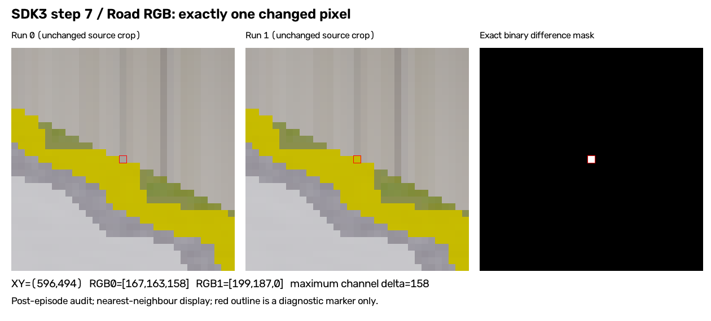

[확인 기록] MetaDrive × MD-V3 7단계 개발 결과

2026-11-16 KST. [Draft PR #132](https://github.com/rownlvh8875-coder/big-model-closed-loop-benchmark/pull/132), 기준 `46b750e6ad8d311b903c1104f12160779ce5806e`. 이전 [SDK3 결과](STAGE7_PANDA_SDK3_RUNTIME_RESULT.md)의 원본 모델 행렬은 3/4 PASS·전체 FAIL이며 그대로 유지한다.

기존 실패는 seed 20261110, s_curve_left_right 조건이다. 두 실행의 첫 6스텝은 모든 기록 필드가 같았다. 7스텝에서 원본 Road RGB·변환 Road RGB·실제 ONNX 입력·행동 출력·재귀 상태가 처음 달라졌고, Wide RGB는 8스텝에서 달라졌다. 에피소드 행의 위치는 행동 적용 후 값이므로, 6스텝 위치의 일치는 7스텝 카메라 진입 시 같은 운동학적 위치였다는 근거다. 7스텝의 행동 적용 후 위치 차이를 영상 차이의 선행 원인으로 해석하면 순서를 뒤집게 된다. 기존 실행에는 그 스텝의 픽셀 바이트가 없고, 기존 픽셀 관찰기는 첫 6스텝만 저장한다.

이번 실험은 같은 조건의 무관찰 대조군 2개 프로세스와 12스텝 CPU 픽셀 관찰군 2개 프로세스를 별도 호스팅 실행환경에서 비교한다. 같은 이미지·SDK3·공식 모델·ORT1.20.1·softpipe·2CPU·10GiB 한도를 사용하고, 호스트 가용 메모리 12GiB를 요구한다. 원래 PSSM/Chase, 964×604 카메라, 변환·I420·모델·행동·재귀·엄격 비교를 유지한다. 이미 CPU에 복사된 배열의 참조만 보존하고 12스텝 에피소드 종료 후 압축한다. 추가 GPU 읽기·렌더링·task tick은 없다. 배열 보존에 따른 메모리·시간 영향은 존재할 수 있다.

원본 실행기는 소스 해시 계약에 묶여 있다. 최초 구현에서 원본 함수에 선택 매개변수를 추가하자 전체 CI의 각 단위 테스트 실행이 5실패·125오류로 해당 계약 충돌을 잡았다. 모든 130개 테스트 이름을 [실패 기록](evidence/sdk3-rgb-forensics-01/source-ci-initial-failure.json)에 보존했다. 원본 파일은 SHA `ddaf0510a775c3a44c908bb4dedf4879ae88bfcb80e1f2d022a8b513a4f42427`로 복원했다. 관찰군은 동일한 함수 코드를 별도 전역 이름 공간에서 실행하면서 관찰기 생성자 하나만 대체한다. 원본 모듈·함수의 전역 값은 바꾸지 않고, 대조군은 원본 함수를 직접 호출한다. 기존 6스텝 관찰기의 기본값과 7스텝 요청 거부도 유지한다.

독립 검토 1회에서 컨테이너 ID 누락 허용, 원본 촬영 방식·사용자·렌더러 환경의 검증 부족을 Important로 확인했다. 원본 해시 계약 회귀와 함께 한 번의 RED→GREEN 수정으로 처리했다. 고정 원본 검사를 포함한 집중·회귀 46건이 통과했다. 일부 압축 손상 입력의 추가 테스트 보강은 Minor로 유보했다. 검토를 반복하지 않았다.

실제 실행 소스는 `937576d2f964baaf1de88bf916d0bdb71280a132`이다. 소스 CI [push43854069925](https://github.com/rownlvh8875-coder/big-model-closed-loop-benchmark/actions/runs/43854069925) / [PR43854078078](https://github.com/rownlvh8875-coder/big-model-closed-loop-benchmark/actions/runs/43854078078)의 4개 작업이 모두 attempt1 SUCCESS·artifacts0이며, 양쪽 단위 로그는 각각 1,929건·7개 제외다. 실행 요청 한 파일만 추가한 activation `bddd41d9f607a6ba20fc65da4291b76837db4b2f`로 [실제 run43854755697](https://github.com/rownlvh8875-coder/big-model-closed-loop-benchmark/actions/runs/43854755697), workflow420027188을 시작했다.

실제 결과: 아래 표는 각 쌍에서 관측한 결과이며 원래 4조건 행렬을 대체하지 않는다.

| 구분 | 새 모델 프로세스 | 추론 횟수 | 쌍 내 엄격 반복성 | 최초 원본 RGB 차이 |
|---|---:|---:|---|---:|
| 무관찰 대조군 | 2 | 24 | PASS | 없음 |
| 12스텝 픽셀 관찰군 | 2 | 24 | FAIL | 7 |

두 독립 컨테이너의 네 모델 자식은 모두 12스텝을 완료했다. 실제 PID·네 개의 서로 다른 UUID, native/Xvfb 종료0, OOM false, 소유 컨테이너 제거를 원본 기록에서 확인했다. 관찰군의 48개 원본 압축 이미지를 모두 제한된 크기로 해제하고 실제 모델 실행의 source SHA와 대조했다. 업로드된 분석과 독립 재계산이 완전히 일치했다.

관찰군 최초 차이는 7스텝이다. road: 변경 픽셀 1개, 최대 채널 차이 158, 경계 [596, 494, 596, 494]. wide: 변경 픽셀 0개, 최대 채널 차이 0, 경계 None. 픽셀 위치는 원인 구분을 위한 관측이며 그림자·재질 등의 고유 원인이나 광학 정확성 증명은 아니다.

control 산출물 14221526330: 326792B / sha256:0bed85cf407144a25ee817e418f32d256f73f496bf05134bdb6569275fab1a15.

full_rgb 산출물 14220249832: 43506956B / sha256:6136240ea3894d5c90b16fa9c0e6c10e5829c59d7565daa00556084f1789aba1.

새 실행은 4 trial·48회 추론이며, 기존 선택 행렬의 8 trial·96회 추론과 분리한다. 기존 실패 조건을 이번 일치 결과로 교체하지 않았다. 따라서 원래 3/4 PASS·전체 FAIL과 7단계 미완료 상태는 유지한다. 큰 원본 ZIP·압축 픽셀·로그는 Actions 산출물과 output에 보존하고, 모든 파일의 크기·SHA·보관 위치를 색인에 남겼다.

근거: [독립 비교](evidence/sdk3-rgb-forensics-01/actual/independent-comparison.json), [원본 산출물 색인](evidence/sdk3-rgb-forensics-01/actual/retained-index.json), [검토·수정](evidence/sdk3-rgb-forensics-01/wholebranch-review.md), [판단 장부](evidence/sdk3-rgb-forensics-01/ledger.md).

실험의 일치·불일치는 관측 결과다. 관찰군이 일치하더라도 무관찰 원본의 반복성 복구나 관찰기 인과효과가 입증되는 것은 아니다. 이전 Both+unsorted 후보의 4/4는 렌더링 조건과 런타임이 다른 별도 결과여서 원본 판정에 합치지 않는다. 기존 요청·판정·모델 가중치를 수정하지 않았으며 main 병합, 환경·레지스트리 게시, 확대 검증, 7단계 완료는 하지 않는다.

최초 차이의 정확한 좌표는 **좌상단 원점·0기준 `(596, 494)`**다. Road 582,256개 픽셀 중 하나, RGB 세 채널만 달라졌다. 실행0은 `[167,163,158]`, 실행1은 `[199,187,0]`이며 최대 절대 채널 차이는 158이다. 동일 스텝의 Wide는 전 바이트 일치한다. 영상상 노란 도로 경계와 회색 면이 만나는 부근이지만, 이 위치만으로 깊이·삼각형·샘플러·그림자 중 고유 원인을 확정하지 않는다.

그림은 에피소드 종료 후 원본 33×33 영역을 최근접 이웃으로 확대했다. 빨간 외곽선은 설명용 표시이며 실제 모델 입력·원본 픽셀에 추가하지 않았다.

| 스텝 | Road 변경 픽셀 | Wide 변경 픽셀 |
|---|---:|---:|
| 1–6 | 각 0 | 각 0 |
| 7 | 1 | 0 |
| 8 | 106,067 | 87,710 |
| 9 | 102,235 | 92,197 |
| 10 | 236,674 | 119,028 |
| 11 | 166,130 | 131,063 |
| 12 | 123,009 | 93,767 |

7스텝 전의 위치·행동·재귀 상태는 동일하다. 8스텝부터는 이미 카메라 진입 위치와 모델 상태가 다르므로 후속 대규모 RGB 차이는 같은 위치에서의 초기 렌더링 차이와 구분해야 한다.

이전 무관찰 실제03의 두 실행과 이번 네 실행의 12스텝 전체 프레임 기록을 변경 없이 교차 대조했다. 이전03 실행0·새 대조군0·새 대조군1·새 관찰군0이 한 그룹으로 정확히 같고, 이전03 실행1·새 관찰군1이 다른 그룹으로 정확히 같다. 이는 새로운 유형의 노이즈가 아니라 앞서 관측한 두 기록 분기가 다시 나타났다는 근거다. 서로 다른 컨테이너의 PID를 바꾸거나 교차 대조를 새 엄격 통과 조건으로 계산하지 않았다. 관찰기의 인과효과나 유일한 렌더러 원인은 여전히 입증되지 않았다.

다음 원인 구분 대상은 해당 한 픽셀의 경계 샘플·깊이·드로우 순서다. 이번에는 관측을 넘어 렌더러를 변경하지 않았으며, 4조건 전체 재검증으로 넘어갈 검증된 수정은 아직 없다.
