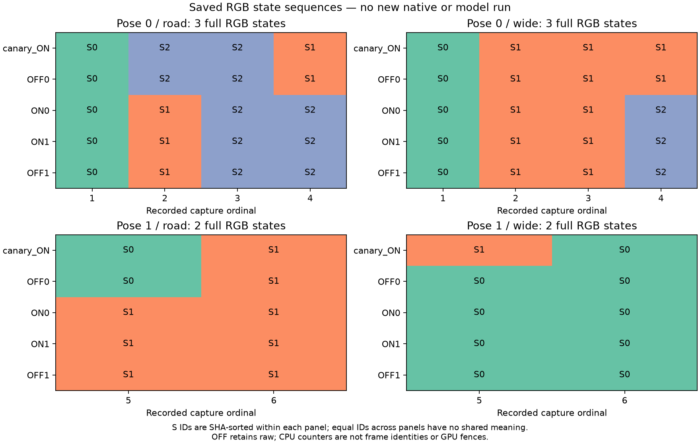

[확인 기록] MetaDrive × MD-V3 7단계 개발 결과

수락된 카메라 원본을 CPU에서 분류했다. 같은 pose·카메라 안에서 전체 RGB 상태는 각각3·3·2·2개였고, 같은 캡처 번호를 실행끼리 비교한 작은 차이의 합집합은6픽셀이었다. 서로 다른 ON process에서 같은 UpdateSeq 값이 다른 RGB에 대응하는 사례와, 한 process에서 RGB는 같지만 표식 값이 다른 사례를 확인했다. **새 native/GPU/ORT/공식 모델 실행은0이며, 이 관측은 stale readback이나 유일한 GPU 원인을 입증하지 않는다.**

## A. 변경과 원본 연결

저장소 `rownlvh8875-coder/big-model-closed-loop-benchmark`, 브랜치 `analysis/texture-marker-state-sequences`다. 도구 실행 source는 `1726d997edf87f13a3688f1e855fa4c9de64ae2e`이며 최종 문서 HEAD와 구분한다. `scripts/texture_marker_state_sequences.py`와 `tests/test_texture_marker_state_sequences.py`, 설계·계획·증거·그림을 추가했다. 기존 producer65/protected13/baseline43/43workflows/소비된request와acceptance/renderer/converter/action/default/6-16-10은 바꾸지 않았다. 분석 도구는 소비된 producer closure에 추가하지 않는다. 기존 continuation 문서만 갱신한다. PR37 위의 별도 Draft로 유지하며 main에 병합하지 않는다.

입력은 이미 수락된 두 원본이다. 새 API 읽기로 run/job/workflow/head/attempt1/성공/유일실행/artifact digest와 크기를 다시 확인했다. 다운로드·재추출·원본 수정은 없었다.

| 입력 | 실제 과거 source / run / job | Artifact / ZIP bytes / SHA256 |
| --- | --- | --- |
| ON canary |`0a98918e746fe7df9d5502e21db91c3e5cd15396` /43177564313 /131045412519 |13925041858 /14,605,800 /`6a8c7a2e3495a5115938d17aee1da8c4e27f4e2ebc1b6350001e0f1090ee1994` |
| ABBA |`4814794243ca61a96264ebe04f4fb1b82f0eeecf` /43178394897 /131048107858 |13925716196 /58,403,425 /`e6017f302e6879709bf089aaeca97fde9ca8828764b645c8e4bde473db6f16ce` |

Workflow415702769/branch diagnostic/texture-generation-markers다. ZIP33/129멤버의 원래 바이트와 기존 추출본이 모두 일치했고, 실제 기록된 source65와 해당 Git blob·현재 생산 소스도 일치했다. 과거의5providers/30pairs/60RGBcopies/72sequence readings는 입력의 역사적 수치이며 이번 분석의 새 실행 수가 아니다.

## B. 전체 RGB 상태와 작은 차이

정확한 NumPy2.4.6/OpenCVheadless5.0.0.93으로 원본을 검증하고 raw→기록된 lens canvas60개와 derived I42030쌍을 재구성했다. 이후60개 raw RGB를 분류했다. 논리 retained raw104,808,960B는128MiB 한도 안이며 RSS 측정은 아니다. 보고서2MiB/각 ordinal cohort 최대32샘플·sparse64픽셀 한도를 적용했다. 실제 cohort는5샘플이다.



그림의 S번호는 각 패널 안에서 전체 RGB SHA를 정렬해 붙였다. 다른 패널의 같은 S번호는 서로 관련이 없다. 캡처1–4는 pose0,t=0이고5–6은 pose1,t=.05다. 이는 virtual pose time과 호출 순서이며 실제 engine frame/time을 측정한 값이 아니다. OFF도 raw retention/wrapper를 사용한다.

Pose0의 첫 캡처는 Road/Wide 모두5실행에서 같은 상태다. 이 공통 첫 상태와 뒤의 상태 사이에는 Road24,898–24,899픽셀,Wide3,196–3,197픽셀이 다르다. 이를 버리거나64픽셀 sparse 조건에 억지로 넣지 않았다. 뒤의 pose0 Road 두 상태는1픽셀/max39,Wide는1픽셀/max35만 다르다. Pose1 Road는3픽셀/max93,Wide는1픽셀/max6이 다르다. 순서가 반복돼 보여도 주기·temporal phase·GPU frame identity를 추론하지 않는다.

같은 ordinal을 실행 사이에서 비교한 support6개는 다음과 같다. RGB쌍은 정렬한 두 관측값이며 시간 방향의 A→B를 뜻하지 않는다. Pose0의 broad 첫 상태는 이 두 값의 목록에서 제외했지만 전체 catalog/그림/원본 보고서에는 보존했다. 좌표는964×604 raw 영상의 좌상단 원점(x,y)다.

| Pose / camera | 좌표 | 작은 차이의 RGB 두 값 | 최대 채널 차이 |
| --- | --- | --- | --- |
|0 / Road |(254,363) |(192,183,130), (196,185,91) |39 |
|0 / Wide |(544,352) |(83,90,26), (97,100,61) |35 |
|1 / Road |(130,351) |(195,185,93), (199,187,0) |93 |
|1 / Road |(552,438) |(114,109,88), (124,119,104) |16 |
|1 / Road |(718,512) |(109,109,86), (122,119,106) |20 |
|1 / Wide |(431,315) |(195,194,196), (199,198,202) |6 |

Canary와ABBA ON0/ON1의 모든 표식 trace는 동일한12..23/pre=post다. 그런데 canary↔ON0와canary↔ON1에는 각각5개의 같은-counter/다른-raw 행이 있다: capture2Road(seq14),capture4Road18/Wide19,capture5Road20/Wide21이다. 두ABBA ON끼리는 그런 행이0개다. 이는 총10개의 쌍별 비교 사례이며 독립적인10개 원인이나 픽셀 수가 아니다.

ON 내부의 같은pose 연속 캡처에서는 raw가 같은데 표식 값이 다른 사례가11개다. 재렌더링 후 픽셀 값이 같아도 metadata가 바뀔 수 있으므로 이 자체는 결함이나 stale image의 증거가 아니다. OFF를 포함하는 표식 비교는 observed=false/값·pattern 비교null로 유지했다. UpdateSeq는 내용 해시도, 프로세스 사이 전역 영상 식별자도 아니다.

[정확한 CPU보고서](evidence/STAGE7_TEXTURE_STATE_SEQUENCES.json)는42,204B/SHA256 `ae4b1a570d18d47128384bee21947a25cb51db1fd6c109d3430d61d778e77a7a`다. 모든 catalog·대표 SHA·샘플 순서·8개 state-edge 차이·12개 ordinal cohort·support RGB·10개 process 비교·11개 내부 사례를 포함한다. [SVG](evidence/STAGE7_TEXTURE_STATE_SEQUENCES.svg)도 보존했다. 그림은 JSON만 읽는 Matplotlib3.11.2/Agg/NumPy1.26.4 환경에서 만들었으며 정확한 image replay 환경과 분리했다.

## C. 소스 참조가 설명하는 경계

[API·소스·검증 audit](evidence/STAGE7_TEXTURE_STATE_SEQUENCES_AUDIT.json)은10개 참조 파일의 SHA·줄 범위·출처를 구분한다. 로컬 MetaDrive0.4.3/Panda1.10.13 배포 metadata는 실제 두 CI 설치 파일/바이너리의 동일성 증명이 아니다. 패키지는 import하거나 실행하지 않고 파일만 읽었다.

보존된 `NativeWorldCamera.capture`는 Road를 perceive한 직후 배열을 CPU복사·hash하고 Wide를 처리한다. 보존된 `RAMCamera.get_rgb_array_cpu`는 `copy_texture.getRamImageAs('RGB')`를 읽고 수직 반전·연속 배열을 만든다. 상위 `ImageBuffer.get_rgb_array_cpu`의 getScreenshot 구현은 이 override가 선택하는 getter가 아니다.

로컬 `BaseCamera.perceive` 참조는 임시world pose를 설정하고 taskMgr.step을 한 뒤 getter를 호출하며 원래 camera parent/pose로 복구한다. 이 API 참조가 CI에서도 같다는 조건에서 논리 경로는 Road task/copy→복구/즉시CPU snapshot→Wide task/copy→복구/snapshot→rectify다. 같은 virtual pose라도 한 쌍을 GPU의 동일 시각·동일 frame에서 읽었다는 뜻은 아니다. 그러나 실제 엔진 프레임·시간·camera transform snapshot이 없어 간격과 위상을 복원할 수 없다.

로컬 simplepbr loader는 `shaders=None`이며 이 참조의 file fallback을 선택한다. embedded tonemap 문자열과 해당파일의 SHA도 동일했다. 읽은 tonemap 파일의 명시적 입력은 tex/exposure/v_texcoord이고 time/frame/random/noise/dither 토큰은 없다. 참조 RGBCamera는 exposure1.0과HDR16bit·MSAA16을 요청한다. 이는 실제 effective sample count나 실행된GPUshader 증거가 아니다. 이 한 파일에서 시간·난수 토큰을 못 찾았다는 결과는 upstream texture/UV/shadow/resolve/driver dither/RAM copy의 영향을 배제하지 않는다.

따라서 구체적인 다음 관측 후보는 기존 Road/Wide task와 CPU복사의 engine frame/time 경계다. 여섯 픽셀의 object/material/depth/coverage/HDR 값이나 원래 차이의 유일 원인은 아직 없다. 이전 CPU 교차조합으로 옛 입력을 맞춘 결과도 실제 동시 프레임이나 모델출력 반사실로 승격하지 않는다.

## D. 검증과 기존 게이트

새18테스트는 SHA분류/첫상태보존/stride·입력불변/signed delta/union cap/OFF null/같은표식의다른RGB/다른표식의같은RGB/signed special값/ZIP변조·unsafe·중복·symlink·추가멤버/출력보존/runtime거부를 검사한다. 초기18개RED는 구현 모듈 부재의 assertion이며 각경계가 독립적으로 RED였다는 주장은 아니다. Targeted18/0.014s와 전체562/72.382s/선택7skip이 통과했다. 새 분석의 native/official/ORT/GPU calls는0이며 baseline generated SMALL graph는 별도다. 최종 source/evidence 독립검토와 기본CI는 Draft 통합 게이트로 별도 기록한다.

공식 strict **FAIL**,확대시나리오 미실행,원래renderer0/4·역사적candidate12/12·geometry original2/4/candidate1/4·물리optics/productionISP/fullS미검증·Stage7미완료는 그대로다. Main공식호출0/Cloud미게시/기존Draft 미병합이다. 원래실패요청이나 수락된 native/model 실험을 재실행하지 않았다.

## E. 다음 순서와 판단

다음 단계에서 먼저 필요한 것은 CPU engine-clock/task-order 관측을 위한 별도 설계다. 실제 frame/time을 읽는 새native가 필요하면 새source/canary/대조·예산을 등록해야 하며 이번 consumed 요청이나 남은 allowance를 재사용하지 않는다. 임의tick/barrier/filter/shader/default 변경도 없다.

Root는 전체RGB catalog+동일ordinal sparse비교(광범위 첫상태 보존,물리frame분류아님),inline+최종독립검토(중간 독립리뷰 없음),원본·workspace보존/CPU전용(디스크/Draft체인 유지),raw128MiB별도한도(RSS·live observer 예산 증명 아님),JSON전용Agg그림/기존환경(figure와image replay 버전이 다름)을 선택했다. 모든 판단·비용을 audit와 ledger에 보존한다.

재현은 기존 ZIP/추출본을 읽고 새출력만 지정한다:

```sh
/workspace/.cloud-tools/stage7/first-divergence-cpu-replay/bin/python -m scripts.texture_marker_state_sequences run \
  --canary-root output/stage7-remote-evidence/run-43177564313/extracted/13925041858 \
  --canary-archive output/stage7-remote-evidence/run-43177564313/13925041858.zip \
  --abba-root output/stage7-remote-evidence/run-43178394897/extracted/13925716196 \
  --abba-archive output/stage7-remote-evidence/run-43178394897/13925716196.zip \
  --out output/stage7-texture-state-sequences/NEW-report.json
```
